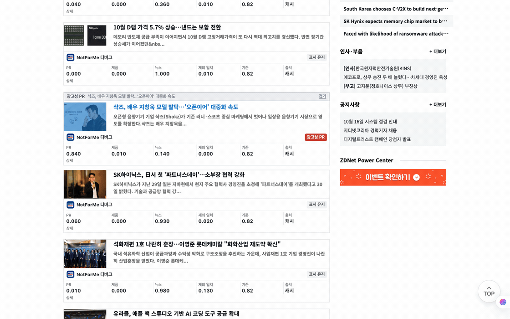

# NotForMe

뉴스 목록에서 광고성 PR 기사, 제품 공개 기사, 관심 주제가 아닌 기사를 한 줄로 접거나 숨기는 Chrome 확장 프로그램입니다. 내 브라우저에서 화면에 표시되는 방식만 바꿉니다.

[English](README.md)



공개된 ZDNet Korea 뉴스 목록에서 촬영한 실제 동작 GIF입니다. 광고성 PR 기사가 접히고 디버그 모드에서 판정값을 보여줍니다.

## 기능

툴바 팝업의 체크박스로 각 필터를 켜고 끕니다.

| 옵션 | 가리는 기사 | 기본값 |
| --- | --- | --- |
| 광고성 PR 기사 없애기 | 할인·행사, 신규 출점·팝업, 협업 한정판, 앰배서더, 행사 방문객 수, 브랜드가 제공한 통계, 협찬 기사 | 켜짐 |
| 제품 공개 기사 없애기 | 기업이 제품·서비스·모델·기능을 공개하거나 출시했다는 내용이 중심인 기사 | 꺼짐 |
| 관심 주제가 아닌 기사 없애기 | 입력한 주제와 관련 없는 기사 | 꺼짐 |

표시 방식은 한 줄 접기(기본값), 블러, 흐리게 표시, 완전히 숨기기 중에서 선택합니다. 숨기기를 제외한 방식은 보기 버튼으로 해제합니다. `[광고]`, `[PR]` 표시는 모델 호출 없이 로컬에서 처리합니다.

지원 화면:

- ZDNet Korea: 홈, 카테고리, 검색
- 연합뉴스: 홈, https://www.yna.co.kr/news
- 한겨레: 홈, https://www.hani.co.kr/arti
- 경향신문: 홈, https://www.khan.co.kr/newest/articles
- 한국경제: 홈, https://www.hankyung.com/all-news
- 동아일보: 홈, https://www.donga.com/news/List
- 이데일리: https://www.edaily.co.kr/
- 전자신문: https://www.etnews.com/
- 블로터: https://www.bloter.net/
- 디지털투데이: https://www.digitaltoday.co.kr/
- 테크M: https://www.techm.kr/
- 보안뉴스: https://www.boannews.com/
- 데일리시큐: https://www.dailysecu.com/
- AI타임스: https://www.aitimes.com/
- 디지털데일리: https://www.ddaily.co.kr/
- 벤처스퀘어: https://www.venturesquare.net/
- 플래텀: https://platum.kr/

지원 사이트의 다른 경로에도 공통 추출기를 적용합니다. 사이트의 페이지 구조에 따라 일부 기사 목록은 감지하지 못할 수 있으며, 별도 모바일 도메인은 포함하지 않습니다.

전용 어댑터가 없는 HTTPS 사이트에서는 팝업의 **이 사이트에서 사용**을 누르고 접근 권한을 허용합니다. 이후 방문에도 적용됩니다.

공통 추출기는 제목 링크가 있는 기사 카드와 목록 항목을 처리합니다. 메뉴, 여러 기사 묶음, 명시적인 기사 본문은 제외합니다. 모든 뉴스 사이트를 지원하지는 않습니다. 팝업에서 감지 건수를 확인하고 **감지 영역 미리보기**로 감지·제외 영역을 8초 동안 표시할 수 있습니다.

놓친 기사는 **기사 직접 선택**을 누른 뒤 제목 링크를 선택합니다. 선택한 URL은 다음 방문에도 기억하며, **저장한 기사 설정**에서 유지·가리기 예외나 직접 지정을 해제할 수 있습니다. 직접 지정 해제는 열린 페이지에 바로 반영됩니다. 기사에 키보드 포커스를 둔 뒤 `Alt+↓`를 누르면 기사별 설정 버튼으로 이동합니다.

팝업의 **설정 백업**에서 필터와 기사별 설정을 내보내거나 가져올 수 있습니다. API 키는 백업하지 않습니다. 팝업에서 실패한 기사만 다시 요청할 수도 있습니다.

디버깅 모드의 상세에서 필터 기준과 판정 사유를 확인하고 해당 기사만 캐시를 건너뛰어 재판정할 수 있습니다. 재판정은 API를 호출합니다. 게시자의 광고 접두사를 이용한 로컬 규칙 판정은 다시 호출하지 않습니다.

## 동작 방식

```
페이지 -> content script -> background worker -> Jev API
          (제목+요약)        (API 키, 캐시)
```

- 제목과 요약 앞 200자만 보냅니다. 기사 본문은 보내지 않습니다.
- API 키, API 주소, 모델은 브라우저 로컬 저장소에 저장합니다. content script의 로컬 저장소 접근을 차단합니다. 키는 동기화하지 않으며, 저장소는 암호화된 비밀 보관소가 아닙니다.
- 필터와 표시 방식 설정, 기사 URL별 예외 및 직접 지정은 `chrome.storage.sync`에 저장합니다.
- 라벨 확률이 판정 기준(기본 0.8) 이상일 때 가립니다. 결과는 기사, 주제, API 주소, 모델, 정의 버전별로 캐시합니다.

## 설치

1. `scripts/package.sh`를 실행하고 생성된 확장 zip을 압축 해제합니다.
2. `chrome://extensions`에서 개발자 모드를 켜고 압축 해제된 `extension` 폴더를 로드합니다.
3. 확장 팝업의 Jev 연결 설정에서 API 키, HTTPS API 주소, 모델을 입력합니다.
4. 연결 설정 저장을 누릅니다. 별도 API 주소에는 접근 권한을 허용합니다.
5. 연결 테스트를 누릅니다. 테스트도 API를 호출합니다.

기본 주소는 `https://api.typesafe.ai/v1/systemone`이고 기본 모델은 `jev-latest`입니다. Node.js 릴레이는 필요하지 않습니다.

## 한계

- 제목과 짧은 요약만으로 판단하므로 애매한 보도자료는 오분류될 수 있습니다. 기준값을 올리면 덜 가립니다.
- 라벨 정의는 `extension/src/background.js`에 있습니다. 정의를 바꾸면 `extension/src/background.js`의 `DEFINITION_VERSION`을 올려 캐시를 버려야 합니다.
- 브라우저 안에서 콘텐츠를 걸러 보는 것이 허용되는지는 국가와 사이트 이용약관에 따라 달라질 수 있습니다. 독일에서는 광고 차단이 소송으로 다뤄졌고 저작권 쟁점은 아직 결론이 나지 않았습니다. 이 도구는 개인 열람용이며, 이 문서는 법률 자문이 아닙니다.

확장은 설정한 API 주소로 제목과 요약 앞 200자를 보냅니다. 설정한 API 제공자의 약관이 해당 데이터 처리에 적용됩니다. 자세한 내용은 [개인정보 처리 안내](PRIVACY.md)와 [보안 정책](SECURITY.md)을 확인하세요.

저장소에는 API 키가 없어야 합니다. 인증 정보와 로컬 설정 파일을 커밋하지 마세요.

## 개발

    npm test
    npm run check
    npm run package
    npm run package:check
    npm run test:browser  # Python Playwright와 Chrome 또는 Chromium 필요

기여 방법은 [CONTRIBUTING.md](CONTRIBUTING.md)를, 취약점 신고 방법은 [SECURITY.md](SECURITY.md)를 확인하세요.
