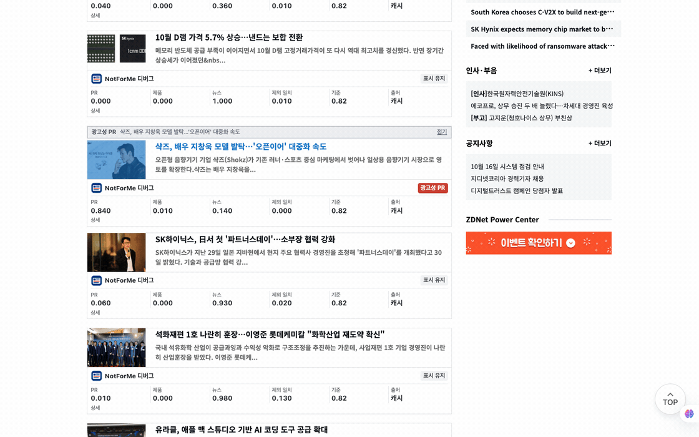

# NotForMe

A Chrome extension that collapses or hides articles on a news list page: advertising PR, product announcements, and anything outside the topics you care about. It only changes how the page is displayed in your own browser.

[한국어](README.ko.md)



This GIF shows NotForMe on a public ZDNet Korea news list. It collapses a matched advertising PR article and shows the classification scores in debug mode.

## What it does

Each filter is a checkbox in the toolbar popup.

| Option | Hides | Default |
| --- | --- | --- |
| Hide advertising PR | Sales and discount events, store openings, pop-ups, brand collaborations and limited editions, ambassadors, event turnout, brand-supplied statistics, sponsored posts | on |
| Hide product announcements | Articles whose main subject is a company announcing or releasing a product, service, model or feature | off |
| Hide off-topic articles | Articles that are not about any topic you list | off |

Select one display mode: collapse (default), blur, dim, or hide. Use the view button to reveal articles, except in hide mode.

Publisher tags such as `[광고]` and `[PR]` use local rules without an API call.

Supported pages:

- ZDNet Korea: home, category lists, search.
- Yonhap: https://www.yna.co.kr/news
- Hankyoreh: https://www.hani.co.kr/arti
- Kyunghyang Shinmun: https://www.khan.co.kr/newest/articles
- Korea Economic Daily: https://www.hankyung.com/all-news
- Dong-A Ilbo: https://www.donga.com/news/List

The five additional adapters support latest article lists only. They exclude home pages, search, category pages, and separate mobile sites.

On other HTTPS sites, select **이 사이트에서 사용** in the popup. Grant access to that site. The extension also runs on later visits.

The common extractor accepts article cards with headline links. It excludes navigation, nested groups, and explicit article bodies.

Some sites do not expose suitable cards. Use the popup and debug mode to inspect the results.

## How it works

```
page -> content script -> background worker -> Jev API
        (title + summary)   (key and cache)
```

The extension sends titles and the first 200 summary characters. It does not send article bodies.

The local store holds the API key, endpoint, and model. Content scripts cannot access this store. Keys do not sync across browsers.

The local store is not an encrypted secret vault. Filter preferences use `chrome.storage.sync`.

Articles use the selected probability threshold (default 0.8). Cache keys include the article, topics, endpoint, model, and definition version.

## Install

1. Run `bash scripts/package.sh`.
2. Extract the extension archive from `dist/`.
3. Open `chrome://extensions`.
4. Enable Developer mode.
5. Select Load unpacked and select the extracted folder.
6. Enter your API key, HTTPS endpoint, and model in the extension popup.
7. Select the button to save the connection settings.
8. If Chrome requests access to the API host, grant access.
9. Select the connection test button. This test makes an API call.

The default endpoint is `https://api.typesafe.ai/v1/systemone`. The default model is `jev-latest`. No local relay is required.

## Develop

```sh
npm test
npm run check
npm run package
npm run package:check
```

The tests use a mock API. They do not spend API credits.

## Limits

- Classification uses only the title and a short summary, so borderline press releases can be misjudged. Raise the threshold to hide fewer articles.
- Label definitions are in `extension/src/background.js`. If you change them, bump `DEFINITION_VERSION` in `extension/src/background.js` so cached results are discarded.
- Whether browser-side content filtering is permitted can depend on the jurisdiction and on a site's terms of use. Ad blocking has been litigated in Germany and a copyright question in that case is still open. This tool is intended for personal reading, and this README is not legal advice.

## Privacy and security

Read [PRIVACY.md](PRIVACY.md) for the data flow and [SECURITY.md](SECURITY.md) for vulnerability reports.

The repository does not contain an API key. Do not commit credentials or local configuration files.

## Contributing

Read [CONTRIBUTING.md](CONTRIBUTING.md) before you open a pull request.
